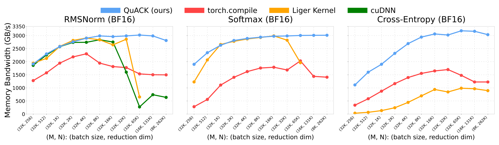

# 🦆 QuACK: A Quirky Assortment of CuTe Kernels 🦆

[ English | [简体中文](https://github.com/Dao-AILab/quack/blob/main/README.zh.md) ]

Kernels are written in the [CuTe-DSL](https://docs.nvidia.com/cutlass/latest/media/docs/pythonDSL/cute_dsl_general/dsl_introduction.html).

## Installation

```bash
pip install quack-kernels

# Optional: install NVIDIA matmul heuristics for better untuned GEMM configs
pip install 'quack-kernels[heuristics]'

# Optional: JAX bindings (pulls in jax and jax-tvm-ffi)
pip install 'quack-kernels[jax]'
```

QuACK supports **CUDA 13 only**. CUDA 12 is not supported.
The `[cu13]` extra is accepted for backward compatibility but adds no dependencies.

## Requirements

- H100, B200/B300, or RTX 50 GPU
- CUDA toolkit 13.x
- Python 3.12

## Kernels 🐥

- 🦆 RMSNorm forward + backward
- 🦆 Softmax forward + backward
- 🦆 Cross entropy forward + backward
- 🦆 Layernorm forward + backward
- 🦆 Hopper gemm + epilogue
- 🦆 Blackwell gemm + epilogue
- 🦆 Blackwell GeForce gemm + epilogue

## Usage

```
from quack import rmsnorm, softmax, cross_entropy
```

JAX bindings are also available for some kernels (see [docs/jax.md](docs/jax.md)):

```
from quack.softmax_jax import softmax
```

## Documentations

- [JAX interface](docs/jax.md) — optional `jax` + `jax-tvm-ffi` bindings, see `quack/softmax_jax.py` for an example.

[2025-07-10] We have a comprehensive
[blogpost](media/2025-07-10-membound-sol.md) on how to get memory-bound kernels
to speed-of-light, right in the comfort of Python thanks to the [CuTe-DSL](https://docs.nvidia.com/cutlass/media/docs/pythonDSL/cute_dsl_general/dsl_introduction.html).

## Performance

<div align="center">
<figure>
  
</figure>
</div>

See our [blogpost](media/2025-07-10-membound-sol.md) for the details.

## Development

To set up the development environment:

```bash
pip install -e '.[dev]'
pre-commit install
```
