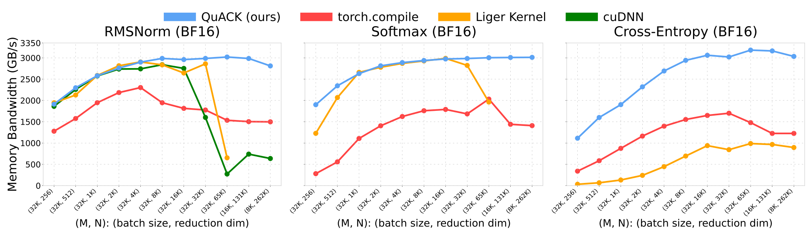

# 🦆 QuACK: A Quirky Assortment of CuTe Kernels 🦆

[ [English](README.md) | 简体中文 ]

算子使用 [CuTe-DSL](https://docs.nvidia.com/cutlass/latest/media/docs/pythonDSL/cute_dsl_general/dsl_introduction.html) 编写。

## 安装

```bash
# 适用于 CUDA 12.9：
pip install quack-kernels

# 适用于 CUDA 13.x：
pip install 'quack-kernels[cu13]' --extra-index-url https://download.pytorch.org/whl/cu132

# 暂请勿使用 uv 安装 CUDA 13.x 版本：它可能会发生竞态，
# 并以错误顺序安装 nvidia-cutlass-dsl[cu13] (NVIDIA/cutlass#3259)：
# https://github.com/NVIDIA/cutlass/issues/3259

# 可选：安装 NVIDIA 矩阵乘法启发式算法库以获取更优的未调优 GEMM 配置
pip install 'quack-kernels[heuristics]'

# 可选：JAX 绑定（将安装 jax 与 jax-tvm-ffi）
pip install 'quack-kernels[jax]'
```

## 环境要求

- H100、B200/B300 或 RTX 50 系列 GPU
- CUDA Toolkit 12.9+
- Python 3.12

## 算子列表 🐥

- 🦆 RMSNorm 前向 + 反向
- 🦆 Softmax 前向 + 反向
- 🦆 交叉熵（Cross entropy）前向 + 反向
- 🦆 Layernorm 前向 + 反向
- 🦆 Hopper GEMM + 后处理（epilogue）
- 🦆 Blackwell GEMM + 后处理（epilogue）
- 🦆 Blackwell GeForce GEMM + 后处理（epilogue）

## 使用方法

```python
from quack import rmsnorm, softmax, cross_entropy
```

部分算子亦提供 JAX 绑定（参见 [docs/jax.md](docs/jax.md)）：

```python
from quack.softmax_jax import softmax
```

## 文档

- [JAX 接口](docs/jax.md) —— 可选的 `jax` + `jax-tvm-ffi` 绑定，示例请参阅 `quack/softmax_jax.py`。

[2025-07-10] 我们撰写了一篇详尽的[技术博客](media/2025-07-10-membound-sol.md)，介绍如何借助 [CuTe-DSL](https://docs.nvidia.com/cutlass/media/docs/pythonDSL/cute_dsl_general/dsl_introduction.html) 直接在 Python 的舒适体验中将受限于内存带宽（memory-bound）的算子性能优化至极致（speed-of-light）。

## 性能表现

<div align="center">
<figure>
  
</figure>
</div>

详细信息请参阅我们的[技术博客](media/2025-07-10-membound-sol.md)。

## 开发指南

配置开发环境：

```bash
pip install -e '.[dev]'
pre-commit install

# 适用于 CUDA 13.x：
pip install 'quack-kernels[dev,cu13]' --extra-index-url https://download.pytorch.org/whl/cu132

# 暂请勿使用 uv 安装 CUDA 13.x 版本；请改用 pip。
# 详见 https://github.com/NVIDIA/cutlass/issues/3259
```

---

*声明：本中文文档由社区志愿者维护，仅供参考。如有出入，请以[英文原版](README.md)为准。*
